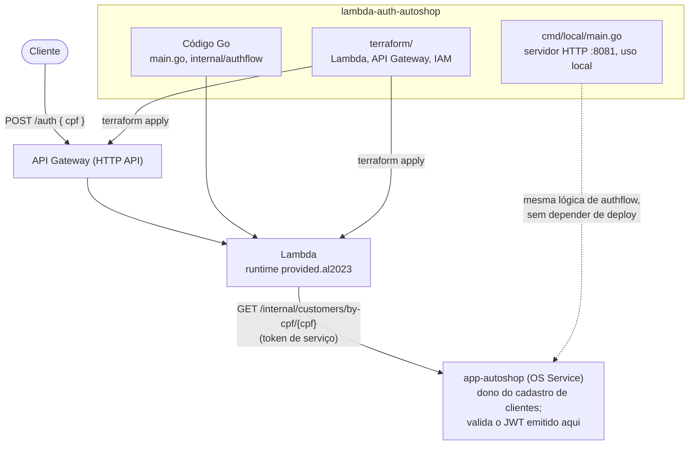

# lambda-auth-autoshop

Function Serverless de autenticação por CPF. Não é login com senha: o
cliente informa o CPF, a function confirma no OS Service (`app-autoshop`)
que existe um cliente ativo com esse CPF e devolve um JWT, no mesmo formato
que a API principal valida (`pkg/auth/jwt.go` do `app-autoshop`).

O cadastro de clientes pertence ao OS Service, e cada serviço tem o próprio
banco. Por isso a function não acessa banco nenhum: consulta a rota interna
`GET /internal/customers/by-cpf/{cpf}` do OS Service, que só aceita tokens
de serviço (role `service`).

Repositórios relacionados: [`app-autoshop`](https://github.com/Jackeline2020/app-autoshop)
(OS Service e orquestrador da Saga), [`execution-autoshop`](https://github.com/Jackeline2020/execution-autoshop),
[`billing-autoshop`](https://github.com/Jackeline2020/billing-autoshop),
[`infra-k8s-autoshop`](https://github.com/Jackeline2020/infra-k8s-autoshop)
(cluster Kubernetes) e [`infra-db-autoshop`](https://github.com/Jackeline2020/infra-db-autoshop)
(bancos gerenciados).

## Arquitetura deste repositório



A regra de negócio (validar CPF, checar existência e status do cliente,
emitir o token) vive isolada em `internal/authflow` e é reaproveitada tanto
pelo handler real da Lambda (`main.go`, via API Gateway) quanto por um
entrypoint de desenvolvimento local (`cmd/local/main.go`) — permite testar
o fluxo completo (CPF → JWT → rota protegida no `app-autoshop`) sem
depender de deploy na AWS a cada mudança.

## Fluxo

```bash
curl -X POST "$AUTH_ENDPOINT/auth" \
  -H "Content-Type: application/json" \
  -d '{"cpf": "529.982.247-25"}'
```

Respostas:

| Situação | Status | Body |
|---|---|---|
| CPF válido e cadastrado | 200 | `{"token": "<jwt>"}` |
| CPF com formato/dígito verificador inválido | 400 | `{"message": "CPF inválido"}` |
| Corpo da requisição malformado | 400 | `{"message": "corpo da requisição inválido"}` |
| CPF válido mas não cadastrado | 404 | `{"message": "cliente não encontrado"}` |
| CPF válido, cliente inativo | 403 | `{"message": "cliente inativo — procure a oficina"}` |
| OS Service indisponível ou erro ao gerar o token | 500 | `{"message": "..."}` |

O token gerado tem `user_id` (o ID do cliente) e `role: "customer"`, expira
em 24h, e é validado pelo `app-autoshop` com o mesmo `JWT_SECRET` — ver
[RFC-003](https://github.com/Jackeline2020/app-autoshop/blob/main/docs/rfc/RFC-003-estrategia-autenticacao.md)
no repositório `app-autoshop` para a justificativa completa da estratégia
de autenticação. Por ser um único endpoint, não há Swagger: o contrato
está na tabela acima.

## Por que Lambda + API Gateway

- **Lambda**: o caso de uso é uma chamada isolada, sem estado, de baixíssimo
  volume comparado à API principal — não justifica manter um serviço
  sempre ligado, e sem custo de execução parada (paga só por invocação).
- **API Gateway (HTTP API, não REST API)**: há uma única rota
  (`POST /auth`) com proxy direto para a Lambda. O modelo REST API traz
  recursos (API keys, validação de requisição) que não são usados aqui e
  custa mais por requisição.
- **`provided.al2023` (custom runtime) em vez de um runtime Go gerenciado**:
  a AWS descontinuou o runtime gerenciado `go1.x` — hoje o caminho oficial
  pra Go é compilar um binário chamado `bootstrap` e rodar em cima do
  runtime customizado `provided.al2023`.

## Tecnologias

- Go, runtime `provided.al2023` (binário `bootstrap`)
- AWS Lambda, API Gateway (HTTP API)
- Terraform (provider `aws`)
- Cliente HTTP da biblioteca padrão para consultar o OS Service

## Pré-requisitos

- Go 1.26+
- Terraform >= 1.5
- OS Service (`app-autoshop`) no ar, com a rota interna acessível pela function

## Variáveis de ambiente (injetadas pelo Terraform em runtime)

| Variável | Origem |
|---|---|
| `OS_SERVICE_URL` | Variável Terraform `os_service_url` (`-var`). Endereço do OS Service |
| `JWT_SECRET` | Variável Terraform `jwt_secret` (`-var`). **Precisa ter o mesmo valor do `app-autoshop`**, senão os serviços não validam os tokens emitidos aqui |

## Execução local (sem deploy)

```bash
cp .env.example .env
go run ./cmd/local
curl -X POST http://localhost:8081/auth -H "Content-Type: application/json" -d '{"cpf": "529.982.247-25"}'
```

Sobe o mesmo fluxo de `internal/authflow` como um servidor HTTP comum na
porta `:8081`, consultando o OS Service configurado em `OS_SERVICE_URL`
(por padrão, o `app-autoshop` rodando localmente na porta 8080).

## Testes

```bash
go test ./...
```

## Build e deploy

```bash
GOOS=linux GOARCH=amd64 CGO_ENABLED=0 go build -o bootstrap main.go

cd terraform
terraform init
terraform plan -var="jwt_secret=<mesmo-valor-do-app-autoshop>" -var="os_service_url=<endereço do OS Service>"
terraform apply -var="jwt_secret=<mesmo-valor-do-app-autoshop>" -var="os_service_url=<endereço do OS Service>"
```

## Pipeline CI/CD (`.github/workflows/ci-cd.yml`)

1. **test** — `go test ./...`.
2. **terraform-validate** — valida o Terraform em toda PR.
3. **deploy** — compila o `bootstrap` e roda `terraform apply`, habilitado
   pela variável `AWS_DEPLOY_ENABLED`. Fica desligado: o state do
   Terraform é local, e a Lambda é aplicada a partir da máquina de quem
   administra o ambiente (seção "Build e deploy").

Secrets usados pelo job: `AWS_ROLE_ARN`, `JWT_SECRET`.
Variáveis: `AWS_DEPLOY_ENABLED`, `OS_SERVICE_URL`.
